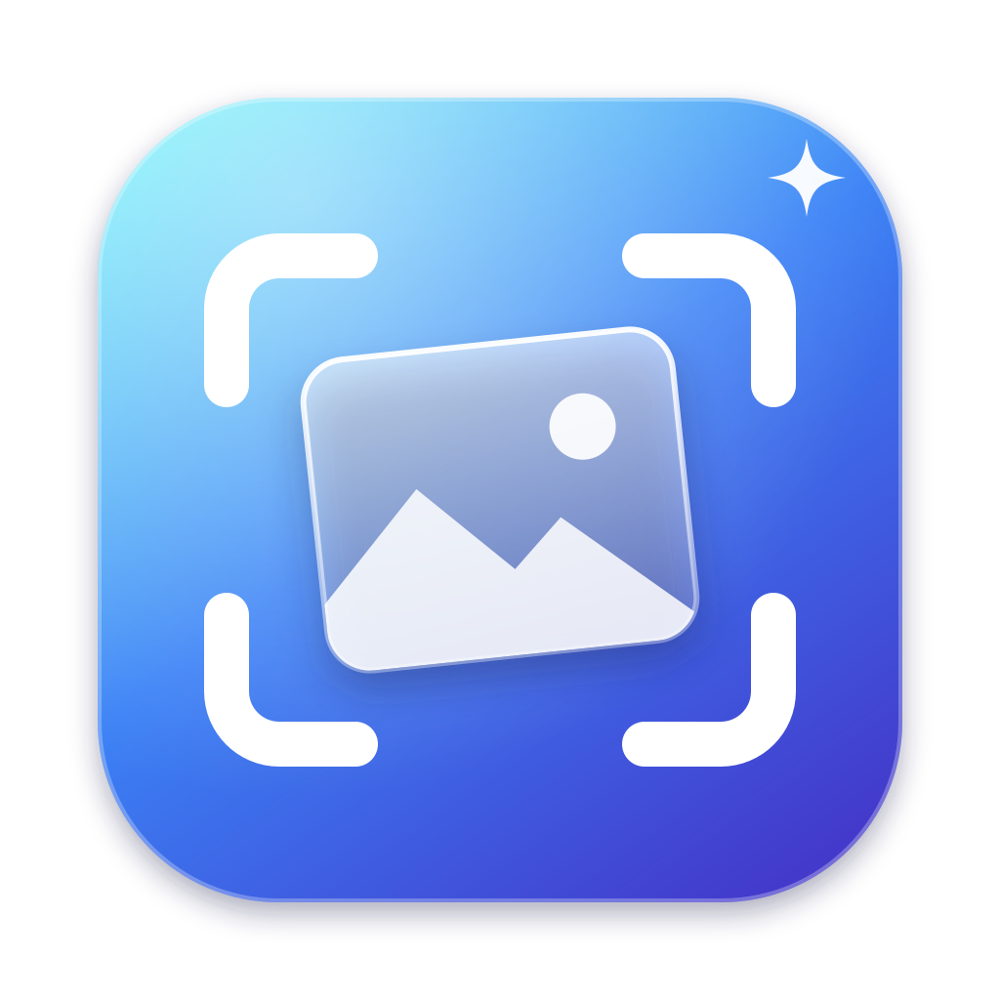

# Snaps

A tiny native macOS menu bar app for screenshots, with a Liquid Glass look.

Every capture goes straight to your clipboard and appears as a floating preview in the corner of your choice, so you can paste it with ⌘V or drag it into any app.

## Shortcuts

| Capture | Default | What it does |
| --- | --- | --- |
| Area | ⌃⇧4 | Drag to select a region |
| Window | ⌃⇧5 | Click a window to capture it |
| Full Screen | ⌃⇧3 | Captures the display under your cursor |
| Gallery | ⌃⇧G | Shows recent captures in a strip across the top of the screen |

Change them in **Settings → Shortcuts**: click a shortcut and type a new combo. Esc cancels, Delete clears it.

## The preview

- Appears in the bottom-left corner by default. Change the corner from the menu bar popover or in Settings.
- Follows your cursor between displays: move to another monitor and the previews hop to that display's corner. They stay put while a mouse button is held, so you can drag one across.
- **Drag** it into Finder, Slack, Mail, a browser, and so on. It dismisses itself after a successful drop.
- **Hover** to reveal buttons for close, pin (keeps it on screen), copy again, save / show in Finder, and open.
- **Double-click** to open the image in Preview.
- Auto-dismisses after 5, 10 or 20 seconds, or stays until you close it.

## The gallery

Press ⌃⇧G, or click **Gallery** in the menu bar popover. A glass strip drops down across the top of the screen, over the menu bar, with your recent captures (newest first).

- **Click** a capture to copy it. **Drag** it into any app. **Double-click** to open it.
- **Hover** for remove, copy and save / show in Finder.
- Press **Esc**, click outside, or press the shortcut again to close it.
- Like the previews, it moves to whichever display your cursor is on.

The gallery keeps your last 60 captures. Unsaved captures are cleaned up after 7 days; anything saved to a folder stays in the gallery as long as the file exists.

## Build and run

Requires macOS 26 or later.

```sh
./Scripts/build.sh          # builds build/Snaps.app
./Scripts/build.sh run      # builds and launches
./Scripts/build.sh install  # builds, copies to /Applications, launches
```

The script compiles with `swiftc` directly. It works with just the Command Line Tools, or with Xcode once its license has been accepted.

### Screen Recording permission

On first launch macOS asks for **Screen Recording** access. Grant it in System Settings → Privacy & Security → Screen & System Audio Recording, then relaunch Snaps. Without it, captures only contain your wallpaper.

The build is ad-hoc signed unless an Apple Development certificate is available, or you set `SIGN_IDENTITY`. With ad-hoc signing, macOS may ask for the permission again after each rebuild. Installing once to `/Applications` and leaving that copy alone avoids this.

## Project layout

```
Sources/Snaps/
  SnapsMain.swift        app entry point (menu bar / accessory app)
  AppCoordinator.swift   wires hotkeys → capture → clipboard → preview
  AppSettings.swift      persisted preferences + runtime state
  Capture.swift          screencapture wrapper, file storage, clipboard
  HotKeyCenter.swift     global shortcuts via Carbon hot keys
  Shortcut.swift         shortcut model + key names
  Preview.swift          floating glass preview panels + stacking
  Gallery.swift          top-of-screen gallery strip
  ScreenFollower.swift   moves floating UI to the cursor's display
  CaptureHistory.swift   recent captures store + thumbnail cache
  PreviewCardView.swift  preview UI and drag-out source
  StatusBar.swift        menu bar item + glass popover
  SettingsView.swift     settings window + shortcut recorder
Scripts/
  build.sh               build/sign/install script
  make-icon.swift        renders the app icon
```
